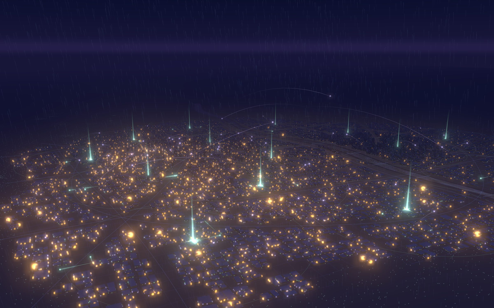
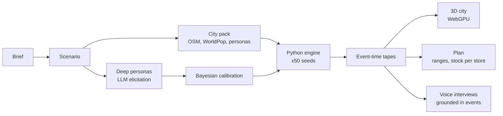

# Twinlight

**Rehearse your launch in a living city.**



Twinlight builds a synthetic copy of a city (its buildings, roads, a hundred thousand residents, the dark stores that deliver in ten minutes and the riders between them), lets your product loose in it for 30 days, and shows you what happens: who hears about it, who orders, which neighbourhoods catch on first, which stores run dry and when. You watch it as a city at dusk that slowly warms from cool tubelight to sodium amber as people buy, and you can stop on any home and ask the person inside why they did or didn't.

Every number comes with a range and can be reproduced from a seed.

> Status: planning complete, building M0. See [docs/PLAN.md](docs/PLAN.md).

## Why
Brands launching on quick commerce face a cold-start problem. Survey tools and synthetic-user panels say whether people like an idea. Forecasting tools say how much to stock from past sales, which a new product does not have. Neither connects how people behave to where stock physically has to sit inside a 2 to 3 km dark-store radius. Twinlight connects the two.

## How it works
- **A real city, synthetic people.** OpenStreetMap buildings and roads, WorldPop population, and census-aligned synthetic personas become households, a social graph and dark stores.
- **A hybrid simulation.** A few hundred deep LLM personas answer a structured questionnaire; a Bayesian model turns their answers into behaviour parameters with uncertainty; a deterministic Python engine (NumPy + Numba) runs 100k lightweight agents and a discrete-event supply model 50 times. The LLM never runs inside the simulation loop.
- **Rendered from event times.** The engine emits when each thing happened; the browser uploads those times to the GPU once and shaders draw any moment of the 30 days instantly. Scrubbing a month is a single uniform change.
- **Honest by design.** Bands on every outcome, a calibration panel that backtests against a brand's real past launches, and narrations whose every sentence links to a moment in the city.



## Stack
Next.js 16 and React 19 (web), three.js with WebGPU and TSL (stage), NestJS (gateway), Temporal (orchestration), Python with NumPy, Numba and FastAPI (engine, tapes, runner) and with NumPyro and DuckDB (personas, calibration, interviews), Postgres with PostGIS and h3, S3-compatible object storage, Redis, OpenTelemetry.

## Repository
```
apps/         web, gateway, worker
packages/     stage, tape, ui, contracts, config
py/           engine, tape (Python libraries)
services/     runner, minds
tools/        citybake
infra/        compose, otel, deploy
design/       tokens, City prototype + toy sim, screen designs
docs/         architecture, model, design, decisions, plan, memory
```

## Getting started
Requirements: Node 24, pnpm 10, Python 3.13 with uv, just, Docker.
```
cp .env.example .env
just setup
just dev          # infrastructure + all apps in watch mode
just fixture      # build the toy city, run the fixture launch, print tape hashes
```
Then open http://localhost:3000/dev/fixture and press play.

## Documents
- [Architecture](docs/ARCHITECTURE.md): components, run lifecycle, tape and city pack formats, API, budgets
- [Simulation model](docs/MODEL.md): awareness, word of mouth, purchases, supply, Monte Carlo, calibration
- [Design](docs/DESIGN.md): visual language, screens, the city layer by layer
- [Decisions](docs/DECISIONS.md): what was decided and why
- [Plan](docs/PLAN.md): milestones and points with acceptance criteria

## How this repo is built
Development runs through Claude Code with the agents, skills and hooks in `.claude/`. Work happens in small branches (`feat/`, `fix/`, `chore/`), one-line Conventional Commits, micro PRs squash-merged after CI and review. See [CLAUDE.md](CLAUDE.md) and [KICKOFF.md](KICKOFF.md).

## Data and attribution
- Map data © OpenStreetMap contributors, ODbL.
- Building footprints where OSM has gaps: VIDA's combined dataset of Google Open Buildings and Microsoft Global ML Building Footprints.
- Population: GHS-POP R2023A, © European Union, JRC, CC BY 4.0.
- Synthetic personas: NVIDIA Nemotron-Personas-India, CC BY 4.0.
All residents are synthetic. No real customer data is used.

## License
To be decided before the repository is made public.
