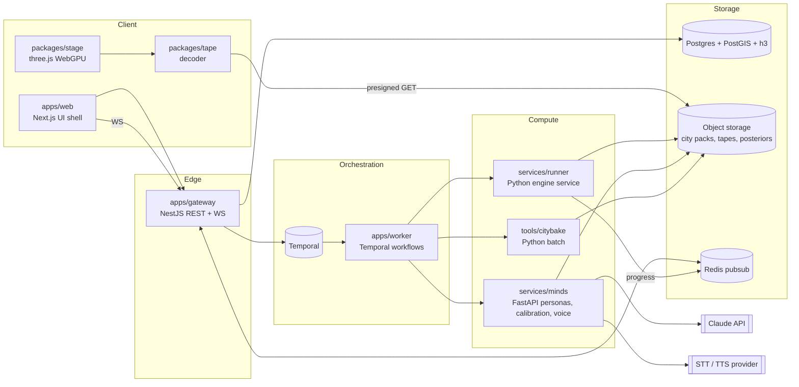

# Twinlight architecture

## 1. What the system does
A user writes a launch brief. Twinlight turns it into a scenario, makes sure a city pack exists for the chosen city, asks a few hundred deep personas how they would react, fits behaviour parameters with uncertainty, runs the deterministic engine for N seeds, aggregates the results into ranges, and streams everything to a 3D client that renders any moment of the 30 days from per-entity event times.



## 2. Components

### apps/web (Next.js 16, React 19)
UI shell, routing, auth session, forms, cards, timeline, Plan view. Mounts the stage through one client component (`<StageHost>`) that owns a `Stage` instance and passes it a tape, layer toggles and the current sim time. React never renders per frame. State: Zustand stores for UI state; server data through TanStack Query against the gateway. Styling: Tailwind v4 with tokens from `packages/ui` exposed as CSS variables. Motion for UI transitions only (Motion for React); the city's motion belongs to the stage.

### packages/stage (three.js)
Framework-agnostic scene engine. Owns the renderer, the render loop, camera director, layers and picking. Public API is small and imperative:
```ts
const stage = await Stage.create(canvas, { tier: 'auto' })
await stage.loadCity(cityPack)
stage.setTape(tape)               // event-time attributes uploaded to GPU once
stage.setTime(simMinutes)          // a uniform update, O(1)
stage.setLayers({ chatter: false })
stage.on('pick', (hit) => ...)     // resident | store | rider
stage.focus({ resident: 4211 })    // camera director
stage.dispose()
```
- Renderer: `WebGPURenderer` with automatic WebGL2 fallback. All materials written in TSL so one shader source runs on both backends.
- Layers: `CityLayer` (instanced buildings from the city pack, roads, river, sky, fog), `ResidentsLayer` (GPU points), `ChatterLayer` (GPU arcs), `StoresLayer` (beams, radius rings), `RidersLayer` (GPU points on precomputed paths), `WeatherLayer` (rain, wet sheen), `SelectionLayer` (rings, labels).
- **Render from event times, not frames.** Each resident carries `aware_at`, `first_order_at`, `order_count`; each chatter arc carries `(from, to, at)`; each delivery carries `(store, resident, ordered_at, picked_at, delivered_at)`. Shaders evaluate state at `uTime`. Scrubbing to any minute is a uniform change. A live run streams day chunks that append to these buffers.
- Picking: GPU id buffer for residents and stores (render ids to a 1x1 target around the pointer), CPU fallback with a spatial hash on WebGL.
- Quality tiers (`auto` picks by GPU timing during the intro): `high` 100k residents, bloom full res; `medium` 60k, bloom half res; `low` 25k, no bloom, no rain particles. Device pixel ratio capped per tier.
- Camera director: intro flight, focus on selection, idle drift, scripted shots for the landing film. Reduced motion swaps flights for cuts.

### packages/tape (TypeScript)
Decodes run tapes (section 4) into typed arrays ready for GPU upload; streaming decode of day chunks; checksum verification. Cross-language goldens against `py/tape`.

### apps/gateway (NestJS)
REST + WebSocket edge. Auth (Google OAuth + email magic link, httpOnly session cookie), orgs, scenarios, runs, plans, backtest uploads, interview sessions, presigned URLs, quotas. Drizzle ORM over Postgres with SQL migrations (PostGIS and h3 types via custom columns). Publishes run progress from Redis to WebSocket subscribers. OpenAPI generated from the zod contracts.

### apps/worker (Temporal TypeScript worker)
Workflows and activities. Activities call the runner and minds over HTTP and citybake as a container job. Every activity is idempotent, keyed by content hashes.

### py/engine (Python library, `twl_engine`)
The deterministic simulation (docs/MODEL.md). Hybrid stepping: behaviour advances in fixed 15-minute ticks as vectorised NumPy operations over struct-of-arrays residents; logistics (orders, picking, riders, restocks) run as a discrete-event queue inside each tick, implemented as Numba `@njit` functions over preallocated arrays. Word of mouth uses a CSR adjacency (offsets, targets) so each tick's conversations are sampled by array indexing, not Python loops. One seed runs in one process; Monte Carlo parallelism is across processes. Random streams come from `SeedSequence(run_seed).spawn(...)`, one per subsystem.

### py/tape (Python library, `twl_tape`)
Tape writer/reader (section 4). Also used by the engine's golden tests.

### services/runner (Python, FastAPI)
`POST /runs` takes `{scenario, city_pack_uri, params_uri, seed}`, runs the engine, streams day chunks to object storage as they complete, publishes progress to Redis, returns the tape URI and hash. Stateless; scale by replicas.

### services/minds (Python 3.13, FastAPI)
- Personas: sample deep personas for a city from the persona pool, stratified by segment.
- Elicitation: structured questionnaires answered by deep personas through the Claude API (Message Batches for bulk), cached and cost-guarded.
- Calibration: hierarchical Bayesian fit of segment parameters (NumPyro) from elicitation + backtests; writes posterior draws to object storage.
- Backtests: fit on a brand's past launch sales, report interval coverage and error (the honesty meter).
- Aggregation: DuckDB over per-seed Parquet summaries to compute quantile bands and the stock plan.
- Interviews: retrieval over a resident's compiled life log (tape events) + persona profile; replies must cite events. Voice: streaming STT -> reply -> streaming TTS over WebSocket with barge-in.
- Narration: run summary where every sentence links to tape event ids.

### tools/citybake (Python batch)
OSM extract plus VIDA's combined Google + Microsoft footprints where OSM has gaps (D-021) -> buildings with heights, road graph; GHS-POP raster (D-025) -> households per building (iterative proportional fitting to district marginals); persona pool -> residents; social graph; dark-store placement; travel-time tables by Dijkstra on the baked road graph (D-022); writes a city pack (section 5).

## 3. The run lifecycle (Temporal `LaunchRun` workflow)
1. `resolveScenario(scenarioId)` -> canonical JSON + `scenario_hash`.
2. `ensureCityPack(city)` -> reuse by `pack_hash`, else start a citybake job.
3. `elicit(scenario_hash, persona_set)` -> cached deep-persona answers.
4. `calibrate(scenario_hash)` -> posterior draws URI (reuse if inputs unchanged).
5. Fan out `runSeed(seed_i)` for i in 1..N (default N=50 in product, 8 in dev) with bounded concurrency. Each seed draws parameters from the posterior using its own stream.
6. `aggregate(run_id)` -> quantile bands, stock plan, next-city ranking (when several cities are in the brief).
7. `narrate(run_id)`.
8. `publish(run_id)` -> status `ready`, notify subscribers.
Signals: `cancel`. Query: `progress`. The gateway can show seed 1 live while the rest run, because the runner streams day chunks.

## 4. Tape format (run output, one per seed)
Binary, little-endian, sections independently zstd-compressed, 8-byte aligned. Designed so the client uploads arrays to the GPU with no per-entity parsing.

```
Header
  magic "TWLT", u16 version, u16 flags
  run_id (16 bytes), u64 seed, engine_version (32 bytes, zero-padded format version string)
  city_pack_hash (32 bytes), scenario_hash (32 bytes)
  u32 sim_minutes (43_200 for 30 days), u32 tick_minutes (15)
  u32 residents, u32 stores, u32 chatter_rows, u32 delivery_rows, u32 stockout_pairs, u32 reserved (0)
  section table: [u32 kind, u64 offset, u64 length, u64 raw_length, u32 crc32] x n
Sections
  RESIDENTS   SoA, count = residents in city pack order
              u32 aware_at        (minutes, u32::MAX = never)
              u32 first_order_at  (u32::MAX = never)
              u16 order_count
              u32 heard_from      (resident index, u32::MAX = paid channel)
              u8  first_source    (0 none, 1 paid, 2 word of mouth, 3 seen nearby)
              u8  outcome_flags   (bit0 hit stockout, bit1 spilled to other store, bit2 gave up)
  CHATTER     sorted by at: u32 from, u32 to, u32 at, u8 kind (1 heard, 2 nudged; D-028)
  DELIVERIES  sorted by ordered_at: u16 store, u32 resident, u32 ordered_at, u32 picked_at, u32 delivered_at, u8 outcome
              (one row per served order; outcome bit0 late, bit1 spilled from the resident's own store;
               picked_at and delivered_at are u32::MAX when they fall after the end of the run)
  STORES      per store: f32 stock[ticks], u16 orders[ticks]; stockout intervals as (u32 start, u32 end) list
              (stock is the level at the end of the tick, orders those served by the store in the tick)
  AGGREGATES  per tick: u32 aware, u32 adopted, u32 orders, u16 stores_out, f32 rain_intensity
              (aware and adopted are cumulative counts at the end of the tick; orders are those placed in the tick;
               stores_out is the number of stores out of stock at the end of the tick; rain_intensity its mean over the tick)
  CHUNKS      index of day chunks for streaming: per day the byte ranges of rows added that day
Footer
  u64 total_length, blake3 hash of everything before it
```
- Streaming: while a run is live, the runner appends day chunks; the client fetches ranges listed in `CHUNKS` and appends to GPU buffers (event arrays are append-friendly because rows are time-sorted or per-entity fixed slots).
- Golden tests: `py/tape` writes `fixtures/tape/v1/*.twlt`; `packages/tape` decodes them and must reproduce the checksums and a set of probe values.
- Reproducibility: the body of the tape is a pure function of `(city_pack_hash, scenario_hash, params_hash, seed)`. Header fields that could vary between runs with the same inputs are therefore fixed or derived: `run_id` is the first 16 bytes of `blake3(city_pack_hash ‖ scenario_hash ‖ params_hash ‖ seed as u64 LE)`, and `engine_version` is the engine's format-relevant version string padded with zeros (not a git describe), so identical inputs give identical bytes and one golden hash. The runner records the git sha and wall clock in its own run metadata, never in the tape.
- Counts live in the header, never inferred from byte lengths: a reader sizes every column from `residents`, `stores`, `ticks = sim_minutes / tick_minutes`, `chatter_rows`, `delivery_rows` and `stockout_pairs`, and `raw_length` is a check, not a source of truth.
- Section kinds: 1 RESIDENTS, 2 CHATTER, 3 DELIVERIES, 4 STORES, 5 AGGREGATES, 6 CHUNKS. `flags` bit0 = complete (footer present). Version 1 writes every column padded to 8 bytes as in the pack format (§5), with each section's compressed bytes 8-byte aligned in the file; `CHUNKS` is empty (one chunk, the whole tape) until streaming lands in P-014.
- TS decode names (`packages/tape`): camelCase of the fields above (`awareAt`, `firstOrderAt`, `storesOut`, ...), times in minutes, `0xFFFFFFFF` = never. Per-store series are flat row-major `[store * ticks + tick]`; stockout intervals are CSR: `stockoutOffsets` (storeCount + 1) indexes (start, end) pairs in `stockoutIntervals`, so the last offset equals `stockoutIntervals.length / 2`. Per store the pairs are sorted by start, disjoint and end-exclusive (out of stock while `start <= t < end`; adjacent intervals are merged); a stockout still open at the end of the run has `end = sim_minutes`. Header exposes `simMinutes`, `tickMinutes`, `seed`.

## 5. City pack format (one per city version)
```
manifest.json      name, bbox, crs, counts, hashes, attributions, version
buildings.glb      meshopt-compressed instanced boxes or extruded footprints (LOD0/LOD1)
roads.bin          polylines for rendering (f32 xy, u8 class: 0 street, 1 arterial incl. ring road, 2 bridge)
river.bin          water polygons (river, lakes)
residents.bin      SoA: f32 x, f32 y, f32 z (floor height), u32 building, u32 hex(h3 res 9 index id), u16 segment, u32 persona_ref, f32 weight (people represented)
graph.bin          CSR adjacency: u32 offsets[n+1], u32 targets[m], u8 tie_kind[m], f32 strength[m]
stores.bin         per store: f32 x, f32 y, u32 hex, f32 radius_m, district id
travel.bin         travel minutes store -> hex (u16), from the baked road graph (D-022), per time-of-day band
hexes.bin          the H3 cells residents and stores refer to
districts.json     names, polygons, marginals used in synthesis
```
Coordinates are local metres in a city-specific projection with the origin at the bbox centre: `x` east, `y` north, `z` up (floor height). The stage maps them to three.js as `(x, z, -y)`, so north is -Z. Packs are immutable and content-addressed by `pack_hash`.

**Binary layout (v1).** Every `.bin` file is a sequence of little-endian columns in the order listed, each zero-padded to a multiple of 8 bytes, so every column starts 8-byte aligned (a client views it as a typed array without copying) and the file size is the sum of the padded columns. Lengths come from `manifest.json` `counts`, which has exactly the keys `buildings`, `residents`, `ties`, `stores`, `roads`, `roadPoints`, `riverPolygons`, `riverPoints`. Variable-length lists are CSR: `u32 offsets[n + 1]`, then the flat columns.
- `buildings.bin` (toy packs, until P-025 brings `buildings.glb`): `f32 x, y, width, depth, height, rotation` (radians about up, counter-clockwise from east), `u16 district`. Count `buildings`.
- `residents.bin`: the columns above. Count `residents`; `building` indexes `buildings`.
- `graph.bin`: directed ties; resident `i` talks to `targets[offsets[i]..offsets[i + 1]]`, and an undirected relation appears in both directions. Count `ties` = length of `targets`. `tie_kind`: 0 household, 1 neighbour, 2 friend, 3 work.
- `stores.bin`: `f32 x, y`, `u32 hex`, `f32 radius_m`, `u16 district`. Count `stores`.
- `roads.bin`: `u32 offsets[roads + 1]` into points, `f32 x[roadPoints]`, `f32 y[roadPoints]`, `u8 class[roads]`.
- `river.bin`: `u32 offsets[riverPolygons + 1]`, `f32 x[riverPoints]`, `f32 y[riverPoints]`, `u8 kind[riverPolygons]` (0 river, 1 lake). One exterior ring per polygon, no holes in v1.
- `hexes.bin`: `u64 h3[hexes]`; `hex` in `residents.bin` and `stores.bin` indexes it densely. Count `hexes`.
- `travel.bin`: `u16 minutes[stores * hexes * bands]`, flat in (store, hex, band) order, whole minutes rounded up, minimum 1, no sentinel (the bake fails on an unreachable pair). `manifest.json` carries `bands`, an ordered list of `{"name", "start_minute"}` (minute of day), and `counts` gains `hexes` and `bands`; the engine reads band boundaries from the pack.
- `districts.json`: `[{"id", "name", "x", "y", "east"}]` ordered by id; real packs add `name_local` (the OSM name when the display name is its English form), polygons (a district can have several parts) and marginals.
- `segment` in `residents.bin` indexes `manifest.json` `segments`, the ordered list of segment names (for Ahmedabad per D-026: senior, young_single, homemaker, working_graduate, working_other, other_adult); the engine and calibration key parameters by that list, never by a hard-coded order.
- `manifest.json`: `{"format": "twinlight-pack", "version": 1, "kind": "toy" | "city", "name", "seed" (toy only), "crs", "bbox": [minX, minY, maxX, maxY], "counts", "files": {name: blake3 hex}, "attributions"}`, written with sorted keys, no insignificant whitespace and no timestamps. `pack_hash` is the blake3 of the manifest bytes.
- Toy packs: `hex` = 0 (no cells and no `travel.bin`), `persona_ref` = `0xFFFFFFFF`, `segment` = age band 0 to 4, `weight` = 1, `crs` = `"local"`. Toy ties are one-way (each resident's out-list, as in the prototype), so a few residents have fewer than 3. They keep the prototype's origin rather than the bbox centre, and the river ring runs past the bbox (6 km either way).

## 6. Data model (Postgres)
```
orgs(id, name, created_at)
users(id, org_id, email, name, created_at)
cities(id, slug, name, bbox geometry(Polygon,4326), pack_uri, pack_hash, version, attributions jsonb)
scenarios(id, org_id, city_id, brief jsonb, canonical jsonb, scenario_hash, created_by, created_at)
runs(id, scenario_id, status, seeds int, engine_version, calibration_id, started_at, finished_at, summary jsonb, error text)
run_seeds(run_id, seed, tape_uri, tape_hash, metrics jsonb, finished_at)
personas(id, city_id, source, source_ref, segment, profile jsonb)
elicitations(persona_id, scenario_hash, prompt_version, model, response jsonb, input_tokens, output_tokens, cost_usd, created_at)
calibrations(id, scenario_hash, posterior_uri, diagnostics jsonb, backtest_id, created_at)
backtests(id, org_id, dataset_uri, coverage80 real, mape real, created_at)
interviews(id, run_id, seed, resident_index, transcript jsonb, created_at)
usage(org_id, day, llm_cost_usd, runs, seeds)
```

## 7. API (gateway, v1)
```
POST /v1/scenarios                    create from brief, returns scenario + hash
GET  /v1/scenarios/:id
POST /v1/runs                         { scenarioId, seeds? } -> runId
GET  /v1/runs/:id                     status, progress, summary
WS   /v1/runs/:id/live                progress events, day-chunk availability
GET  /v1/runs/:id/seeds/:seed/tape    presigned URL (short TTL)
GET  /v1/runs/:id/plan                bands, stock plan, ranking, calibration
GET  /v1/cities                       available cities
GET  /v1/cities/:slug/pack            presigned manifest URL
POST /v1/runs/:id/interviews          { seed, residentIndex } -> session
WS   /v1/interviews/:id               text or voice turns (proxied to minds)
POST /v1/backtests                    CSV upload (date, sku, city, units) -> backtest id
GET  /v1/me/usage
```
All request and response shapes are zod schemas in `packages/contracts`.

## 8. Cross-cutting
- **Observability:** OpenTelemetry in every service (NestJS and FastAPI). Dev runs the Grafana LGTM container. Trace ids flow from the gateway through Temporal into runner and minds. The stage reports frame-time percentiles and tier to the gateway (sampled) for real-device performance data.
- **Security:** sessions are httpOnly cookies; tapes and packs via presigned URLs with short TTLs; LLM and voice keys only in minds; uploads limited in size and validated by schema; per-org quotas on seeds and LLM spend; no PII anywhere (residents are synthetic).
- **Costs:** LLM use is bounded per run (deep personas x questions, cached); interviews metered per minute; the cost guard rejects work that would exceed the org's daily cap.
- **Attribution:** OSM (ODbL), VIDA combined building footprints with Google Open Buildings and Microsoft Global ML Building Footprints (D-021), GHS-POP R2023A (CC BY 4.0, © European Union, JRC; D-025), Nemotron-Personas-India (CC BY 4.0) credited in the app footer and in `manifest.json`.

## 9. Performance budgets
| Area | Budget |
| --- | --- |
| Engine, 100k residents, 30 days, one seed | under 10 s on one modern core |
| Run of 50 seeds on an 8 vCPU box | under 90 s wall time |
| City pack first-load download (Ahmedabad: buildings, roads, residents, stores) | under 6 MB compressed (D-031) |
| City pack engine-only files (graph, travel, cells, engine resident columns) | under 10 MB, soft, reported in the manifest |
| Tape per seed | under 3 MB compressed |
| First city frame on a mid laptop, cold cache | under 2.5 s |
| Frame time, default tier | 16.7 ms p95 on an M1 / RTX 3060 class GPU; 33 ms p95 on a mid Android phone at `low` |
| City page JS (excluding three) | under 250 KB gzipped |
| Voice interview, first audio after user stops | under 800 ms p50 |

## 10. Deployment
Docker images per service. Single VPS with Coolify to start: web, gateway, worker, runner (2 replicas), minds, Temporal (with its Postgres schema), Postgres, MinIO, Redis, otel-lgtm. Object storage can move to R2 or S3 without code changes (S3 API). Web can move to Vercel if edge latency matters. Backups: nightly Postgres dump + object storage lifecycle rules (tapes older than 90 days pruned unless pinned).

## 11. Local development
`just dev` starts `infra/compose/dev.yml` (postgres with postgis + h3, minio, redis, temporal, otel-lgtm) and runs apps in watch mode. `just fixture` builds the tiny procedural fixture city, runs the fixture scenario for 2 seeds, writes tapes to MinIO and prints hashes. The web app has a `/dev/fixture` route that loads the fixture tape without auth.
